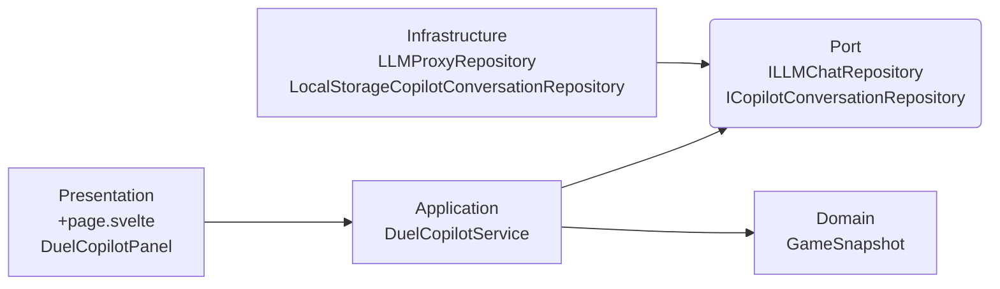

# Duel Copilot 設計

## 概要

Duel Copilot は、現在のゲーム状態を LLM に渡し、次の行動を提案する「AI デュエルアシスタント」機能。

- ゲーム状態（`GameSnapshot`）とデッキ情報をプロンプトに変換し、LLM へ送信する
- 会話履歴を保持し、フォローアップ質問に対応する
- `moveCount` による時系列情報で、盤面変化後の追加質問にも対応する

---

## 依存関係



- `+page.svelte` はインフラ実装を注入し、`DuelCopilotService` を生成し、`DuelCopilotPanel.svelte` を表示する（Composition Root）
  - `DuelCopilotPanel.svelte` は `DuelCopilotService` を呼び出し、UI コンポーネントを提供する
- `DuelCopilotService` は会話管理と LLM 呼び出しを担う
  - インフラに直接依存せず、Port 経由のみ
- `ILLMChatRepository` / `ICopilotConversationRepository` は Port（契約）であり、インフラ実装を抽象化する
  - `LLMProxyRepository` が `ILLMChatRepository` を実装し、外部 LLM API プロキシと通信する
  - `LocalStorageCopilotConversationRepository` が `ICopilotConversationRepository` を実装し、会話履歴を localStorage に永続化する

---

## 主要コンポーネント

- **`DuelCopilotService`**: 会話管理と LLM 呼び出しを担うユースケースサービス
  - 主要メソッド:
    - `requestHint(deckData, snapshot, onChunk)` - 会話履歴をリセットし、現在盤面のヒントを取得する
    - `sendMessage(message, snapshot, onChunk)` - 会話を継続しながら追加メッセージを送信する
      - `snapshot`（`moveCount` 含む）を受け取り、毎回現在盤面をメッセージ先頭に差し込む
      - `moveCount` はコマンド実行のたびに自動インクリメントされ、コパイロット側で計算不要
      - これにより LLM が複数ターンにわたる会話履歴で時系列と盤面変化（何手前の状態でどう回答したか）を把握できる
    - `getHistory()` - 現在の会話履歴を返す
    - `restoreHistory()` - localStorage から会話履歴を復元する
    - `clearHistory()` - 会話履歴をリセットし、localStorage からも削除する
  - 実装コード: `application/copilot/DuelCopilotService.ts`

- **`contextBuilder`**: プロンプト文字列を組み立てる純粋関数群
  - 主要関数:
    - `buildDuelCopilotPrompt(deckData, snapshot)` - `requestHint` 用の初回フルプロンプトを組み立てる
      1. システムプロンプト（LLMのロール定義）
      2. `## デッキの回し方`（guide が設定されている場合のみ）
      3. `## 手札・フィールドのカード定義`（DSL テキスト、カードがある場合のみ）
      4. `## 現在のゲーム状態 (move: N)`（JSON）
      5. `## 質問`（固定メッセージ）
    - `buildStateUpdatePrefix(snapshot)` - `sendMessage` 用の盤面更新プレフィックスを生成する
      1. `## 現在のゲーム状態 (move: N)`（JSON）
  - 実装コード: `application/copilot/contextBuilder.ts`

---

## 今後の拡張アイデア

### Phase 2: ツール使用（エージェンティック）

LLM に「合法手を問い合わせる」「カード定義を引く」ツールを渡し、LLM 自身が必要な情報を取得して根拠のある提案を生成する。

ツール候補:

| ツール名             | 引数        | 返却                                     | 実装元                       |
| -------------------- | ----------- | ---------------------------------------- | ---------------------------- |
| `get_legal_actions`  | `phase`     | 現在発動可能な行動一覧                   | `ChainableActionRegistry`    |
| `get_card_details`   | `cardName`  | カード効果 YAML 定義                     | `CardDataRegistry` / DSL     |
| `get_action_history` | ─           | このターンの行動履歴（moveCount ベース） | `gameStateStore`             |
| `evaluate_sequence`  | `actions[]` | 行動列の合法性判定                       | 各 Command の `canExecute()` |

ツールの実行はすべてクライアント完結（サーバーラウンドトリップ不要）。

### Phase 3: 構造化提案 → カードハイライト

LLM 出力を JSON モードで構造化し、UI 上で次に操作すべきカードをハイライト表示する。

```typescript
interface CopilotProposal {
  nextAction: {
    cardInstanceId: string; // ハイライト対象カードの instanceId
    actionType: "activate" | "summon" | "set" | "advance_phase";
    reason: string;
  };
  plan: string[]; // この後の大まかな流れ
}
```

### Phase 4: オートプレイ（将来）

LLM が提案 → ユーザー確認 → Command 発火 → 新スナップショット → 再提案、のループ。  
ゲームエンジン側のチェーン・誘発効果実装が十分に安定してから着手する。
