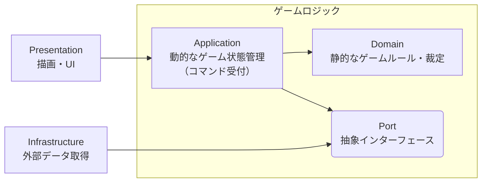

# ソフトウェアアーキテクチャ

コンセプトは **ドメイン中心の 4 層クリーンアーキテクチャ**。  
変わりにくいもの（ゲームロジック）を中心に、変わりやすいもの（UI・外部データ）を外側へ配置する。  
これによりゲームロジックを UI・外部データから完全に分離し、変更に強くテストしやすい構成にする。

---

## クリーンアーキテクチャの全体像

| 層                               | 責務                                                   | 変わりやすさ         |
| -------------------------------- | ------------------------------------------------------ | -------------------- |
| **Domain**（ドメイン層）         | ゲームルール・カードの裁定（場でどう振る舞うか）       | 変わりにくい（中心） |
| **Application**（アプリ層）      | 盤面の進行・ゲーム状態の更新（今どうなっているか）     | 中間                 |
| **Infrastructure**（インフラ層） | カードのテキストや画像を外部カードDB／ローカルから取得 | 変わりやすい         |
| **Presentation**（プレゼン層）   | 盤面の描画、クリックの受付                             | 変わりやすい（外縁） |

**ディレクトリ構造**

```
skeleton-app/src/lib/
├── domain/          # ドメイン層
├── application/     # アプリ層
├── infrastructure/  # インフラ層
└── presentation/    # プレゼン層
```

### 内側（ゲームロジック）と外側の境界

遊戯王のカードは、**テキスト**（札に刷られた文面。期・レイアウトで書式が変わる表示用データ）と **裁定**（文面に明示されない分も含む、カードの振る舞いを定めるルール）に分けられる。  
ゲーム進行を決めるのは裁定であり、テキスト・画像は表示用データにすぎない。

したがって、変わりにくい「ゲームロジック＝ゲームルール・カードの裁定」を内側（ドメイン層・アプリ層）に、可変寄りの「テキスト・画像・UI」を外側（インフラ層・プレゼン層）に置く。

ゲームロジックがテキスト・画像・UI を参照しないことで、次が成立する。

- UI や外部データ取得方法を変更しても、ゲームロジックは改修不要。
- ゲームロジックを UI・外部データなしで単体テストできる。
  - 例: 《強欲な壺》の発動でデッキ −2・手札 +2 を検証

### ドメイン層とアプリ層の境界

ゲームロジック内部のドメイン層／アプリ層の境界は、**静的なルールか、動的な状態か**で分ける。

- **静的なルール（ドメイン層）**: 盤面に依存せず定義できるゲームルール・カードの裁定。例: 《強欲な壺》の「発動時にデッキを 2 枚ドローする」。
- **動的な状態（アプリ層）**: その試合その瞬間のみの可変情報。例: デッキ残枚数、ドロー後の盤面。「デッキが 1 枚なら 2 枚引けない」等の制約判定を担う。

判定基準は「ゲーム開始前に確定しているか」。Yes ならドメイン層、No ならアプリ層。

---

## 依存の向きとアクセスパターン

**依存は外側→内側の一方向のみ。内側は外側を参照しない。**



図の全矢印が内向きであることがこの規則を表す。  
内側（ゲームロジック）は外側が無くても単体で動作・テストできる。

無秩序にゲームロジックに触れる口を開けると境界が崩れるため、外側から内側へのアクセスパターンを次の経路に限定する。

| 境界           | アクセスパターン   | 効果                                                                     |
| -------------- | ------------------ | ------------------------------------------------------------------------ |
| インフラ層から | **Port + Adapter** | 取得は Port 経由のみ。供給元（外部DB／ローカル）をゲームロジックから隠蔽 |
| プレゼン層から | **Facade**         | UI の操作を単一窓口に集約。ゲームロジックの内部構造を UI から隠蔽        |

### Port + Adapter: 依存性逆転（Dependency Inversion）

インフラ層はデータ供給側だが、依存はインフラ層 → Port（内側）に向ける。

ゲーム側が取得データの契約（Port）を内側に定義し、インフラ層がそれを実装することで、供給側が内側に依存する形にしている。
結果として、**利用方向（内側→インフラ層）** と **依存方向（インフラ層→内側）** が逆転し、利用側（ゲームロジック）が主導権を保持する。

### Facade: ゲーム操作の受付窓口（`GameFacade`）

プレゼン層からゲームロジックへの操作は、すべて `GameFacade` の公開エンドポイント経由に限定する。

UI はエンドポイントを呼ぶだけで、内部の Command 実行・ドメイン層呼び出し・Store 更新の順序や構造を知らない。  
結節点を 1 箇所に集約することで、ゲームロジック内部の変更が UI に波及しないようにする。

---

## データフロー

1 アクションの流れで各層の分担を示す。

1. ゲーム開始時、**インフラ層** が外部カードDBからデータを取得し、`Port` の契約形で返す
2. **プレゼン層** がユーザーのクリックを受け取る
3. **プレゼン層** が **アプリ層** の `GameFacade` を呼ぶ
4. **アプリ層** が **ドメイン層** のゲームルールを呼ぶ
5. **ドメイン層** がルールを執行し、新しい GameState を返す
6. **アプリ層** がその GameState でストアを上書きする
7. **プレゼン層** がストアの変更を検知して再描画する

ゲームロジックへの入口は `GameFacade` のみ、ゲームロジックからの出力は新しい GameState のみ。この一方向フローが境界を維持する。

---

## 各層の責任と構造

### ドメイン層（Domain Layer）

遊戯王のルール（[game-rules/](../game-rules/overview.md)）そのものをコードで表現する、外部非依存の層。  
Pure TypeScript で書き、Svelte や DOM を持ち込まない（ロジック単体でテスト可能）。

**ディレクトリ構成**:

```
skeleton-app/src/lib/domain/
├── models/      # 各種データモデル
├── rules/       # 基本ルール
├── cards/       # カードデータ定義
├── dsl/         # DSL エンジン（部品、インスタンスファクトリ等）
├── effects/     # 各種効果処理
│   ├── actions/ # 発動する効果（チェーンブロックを作る処理）の具象実装
│   ├── rules/   # 適用する効果（追加適用するルール）の具象実装
│   └── shared/  # 効果処理の共通部品
└── commands/    # ゲーム操作の具象実装（Command Pattern）
```

**主要コンポーネント**:

- **GameState**: イミュータブルなゲーム状態モデル。詳細は [game-state-model.md](./game-state-model.md)
- **GameCommand**: ゲーム操作の具象実装（Command Pattern）。詳細は [game-state-model.md](./game-state-model.md)
- **CardDataRegistry**: Card ID → カードの静的データ。詳細は [card-model.md](./card-model.md)
- **効果 Registry**: Card ID → カードの効果。詳細は [effect-model.md](./effect-model.md)
  - **ChainableActionRegistry**: 発動する効果
  - **AdditionalRuleRegistry**: 適用する効果
- **DSL 部品 Registry**: 名前 → 再利用可能な DSL 部品。詳細は [dsl.md](./dsl.md)
  - **AtomicConditionRegistry**: 条件名 → 発動条件チェック関数
  - **AtomicStepRegistry**: ステップ名 → 効果処理ステップ生成関数
  - **ActionOverrideRegistry**: Override 名 → 処理置換ハンドラ
- **DSL エンジン**: YAML 定義を解釈し、上記 DSL 部品を組み立ててカードデータ・効果を生成、各 Registry に登録する処理系。詳細は [dsl.md](./dsl.md)

### アプリ層（Application Layer）

ユーザー操作を Command としてドメイン層に伝え、結果を Store に反映する（動的ゲーム状態管理）。  
ドメイン層とプレゼン層の間のデータ変換も担う。

**ディレクトリ構成**:

```
skeleton-app/src/lib/application/
├── ports/         # Port Interface（インフラ層への依存抽象化）
├── types/         # DTO（DisplayCardData, DeckRecipe 等）
├── decks/         # サンプルデッキレシピ等の静的データ・デッキローダー
├── factories/     # ドメインモデル → DTO 変換ファクトリ
├── stores/        # Svelte Store による状態管理
├── copilot/       # Duel Copilot（LLM アシスタント機能）
└── GameFacade.ts  # プレゼン層とドメイン層の橋渡し（Facade Pattern）
```

**主要コンポーネント**:

- **GameFacade**: UI からの単一窓口。Commands を呼び出して結果を Store に反映し、Store 更新の責任を一元管理する
- **Stores**: Svelte Store（`writable` / `derived`）で状態変化を UI に通知する。不変更新で再描画を最適化する
- **Ports**: インフラ層への依存を抽象化する（例: `ICardDataRepository`）
- **DTO**: `DisplayCardData`（UI 表示用、ドメイン層の `CardData` と区別）、`DeckRecipe`（デッキレシピ定義）

### インフラ層（Infrastructure Layer）

外部 API（YGOPRODeck API v7 等）との統合を Port/Adapter で抽象化し、アプリ層から外部リソースへの依存を隔離する。

**ディレクトリ構成**:

```
skeleton-app/src/lib/infrastructure/
├── adapters/  # Port/Adapter 実装（YGOProDeckCardDataRepository 等）
├── api/       # 外部 API 統合（YGOPRODeck API v7、型定義、死活監視）
└── utils/     # HTTP 通信ヘルパー（fetch wrapper）
```

**主要コンポーネント**:

- **Adapters**: アプリ層の Port（`ICardDataRepository`）を実装（`YGOProDeckCardDataRepository`）
- **API クライアント**: YGOPRODeck API v7 との HTTP 通信・死活監視
- **キャッシュ**: 取得結果をセッション単位でメモリキャッシュし、重複リクエストを防ぐ

### プレゼン層（Presentation Layer）

Store の状態を画面に描画し、ユーザー入力を受け取る。UI 状態管理（モーダル表示・カード選択等）と UI 専用ユーティリティ（ナビゲーション・アニメーション・音声再生等）を担う。  
表示ロジックのみを持ち、ゲームロジック（攻撃力計算等）はアプリ層／ドメイン層に委譲する。

**ディレクトリ構成**:

```
skeleton-app/src/lib/presentation/
├── components/  # UI コンポーネント（Atomic Design）
├── stores/      # UI 状態管理（カード選択、モーダル表示、テーマ、音声）
├── services/    # 表示用データ変換・キャッシュ（displayDataCache 等）
├── types/       # アプリ層からの型再エクスポート（後方互換性）
├── utils/       # UI 専用ユーティリティ（ナビゲーション等）
├── sounds/      # 効果音・BGM 定義
├── assets/      # 画像ファイル
└── constants/   # UI 定数値
```

**主要コンポーネント**:

- **Components**: Atomic Design 構成の UI 部品（atoms 等）
- **UI Stores**: カード選択・モーダル表示・テーマ・音声などの UI 状態管理
- **Services**: Infra 由来の表示データの変換・キャッシュ（displayDataCache / displayInstanceAdapter）
- **Utils**: ナビゲーション・アニメーション・音声再生等の UI 専用処理
