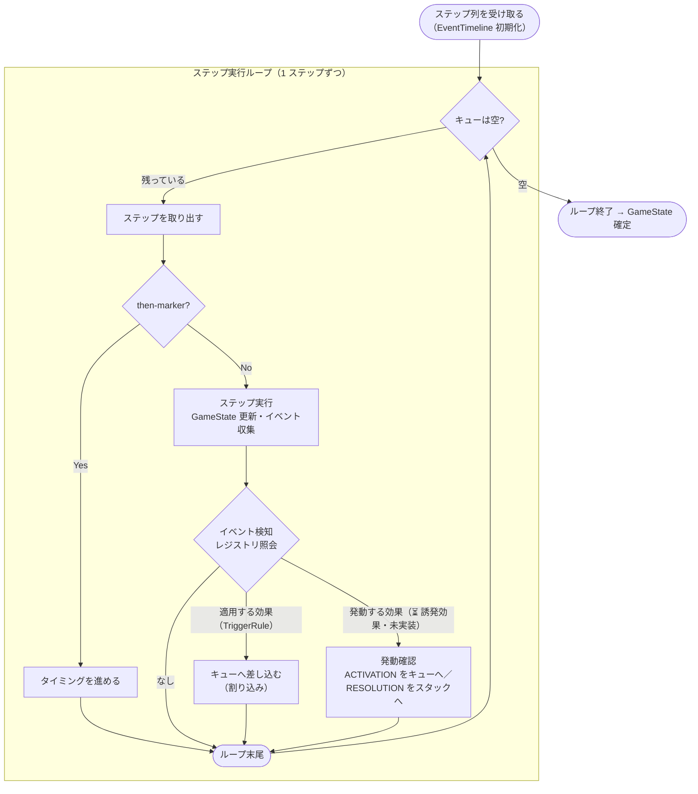
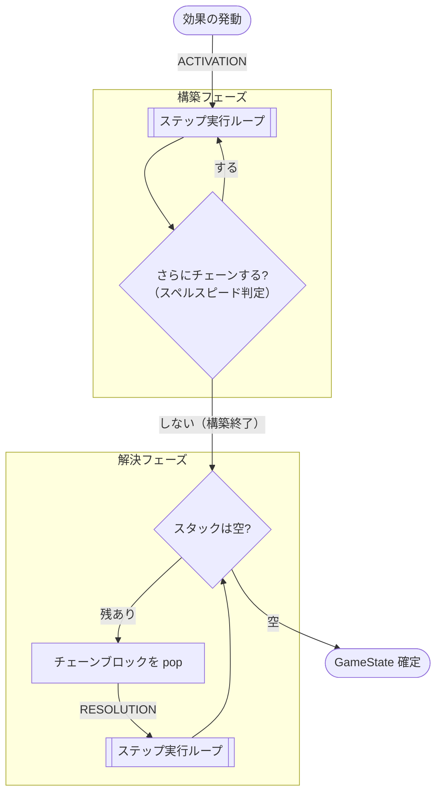
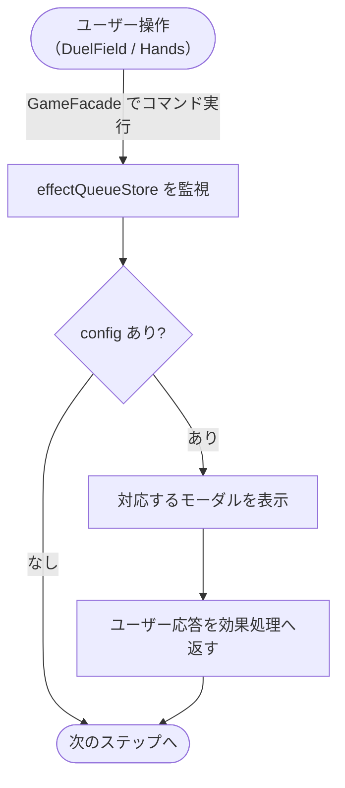

# Effect モデル設計

遊戯王の「効果」をどうコードへ写すかを扱う。  
効果には、プレイヤーが発動を宣言する **発動する効果**（チェーンブロックを作る）と、盤面に反応して自動で効く **適用する効果**（チェーンブロックを作らない）の 2 系統がある。  
効果分類そのもの（ルール）は [効果の分類](../game-rules/effect.md)・[チェーンシステム](../game-rules/chain.md) を参照し、ここでは再説明しない。

本書は、その 2 系統を **どの層にどう配置し、どう進行させるか** の設計を扱う。  
レイヤー構成と依存方向は [architecture.md](./architecture.md)、カードデータ側は [card-model.md](./card-model.md) を参照。

---

## 2 種類の効果と、主役になる層

効果モデルの出発点は、「その効果の **主語は誰か**」という軸である。  
主語が変わると、コードの **主役になる層** が変わる。

- **発動する効果** は、**プレイヤーが発動を宣言する**。入力（宣言）に対して出力（次の状態）が一意に決まるため、純粋関数の置き場所である **ドメイン層** が主役になる。
- **適用する効果** は、**ゲームが自動的に適用する**。発動宣言を待たず、盤面の出来事に反応してこちらの処理に割り込んでくる。「中断と再開を繰り返す進行」は純粋関数に収まらないため、動的な状態を管理する **アプリ層** が主役になる。

|                  | **発動する効果**                    | **適用する効果**                   |
| ---------------- | ----------------------------------- | ---------------------------------- |
| 主語             | プレイヤーが発動宣言                | ゲームが自動適用                   |
| チェーンブロック | 作る                                | 作らない                           |
| ドメイン層の抽象 | `ChainableAction`（PSCT 3 部構造）  | `AdditionalRule`（ルールへの介入） |
| 定義レジストリ   | `ChainableActionRegistry`           | `AdditionalRuleRegistry`           |
| 進行の主役       | ドメイン層（入力 → 出力の純粋関数） | アプリ層（逐次進行・割り込み制御） |

どちらの効果も、状態更新はドメイン層の **GameProcessing 共通基盤** を通す（後述）。  
アプリ層のストアは「いつ・どの順で・何を差し込むか」の進行制御だけを担い、「呼ばれた処理が何をするか」はドメイン層に留める。  
この分担を崩すとアプリ層が God Object 化し、ドメイン層が貧血化するため、境界を常に意識する。

---

## 処理フロー

コマンド選択から UI 表示までの流れで、各層の分担を示す。

1. **プレゼン層** がユーザーのコマンド選択を受け取り、**アプリ層** の `GameFacade` を呼ぶ
2. **アプリ層** の `GameFacade` が **ドメイン層** の Command を実行し、GameState を更新して効果処理ステップを生成する
3. **アプリ層** の `effectQueueStore` がステップを逐次実行し、イベント検知による割り込みと、通知／カード選択のプレゼン層への委譲を行う
   - チェーンが絡む場合、`effectQueueStore` は **アプリ層** の `chainStackStore` と連携し、構築フェーズで RESOLUTION を積み、解決フェーズで逆順に解決する（限定版スタック）
4. **プレゼン層** の Modal が確認・カード選択・チェーン確認の UI を表示し、ユーザー操作を効果処理に反映する

ゲーム操作コマンドは [ゲーム操作](../game-rules/command.md)、`GameFacade` の役割は [architecture.md](./architecture.md) を参照。

---

## GameProcessing : ゲーム状態更新の共通基盤

発動する効果も適用する効果も、状態更新は **同じ語彙** を通して行う。  
これを束ねたのがドメイン層の `GameProcessing` モデルで、`Effect` も `Command` もこの基盤を経由して状態を更新する。

**関連ファイル**: `domain/models/GameProcessing/`

- **`AtomicStep`**: 処理の最小単位。割り込みで差し込める、ゲーム状態更新のステップ
- **`GameEvent`**: 「何が起きたか」。`spellActivated` のような、pub/sub で流れるイベントの型（`EventType`）
- **`GameStateUpdate`（`Result`）**: 「状態がどう変わったか」を表す共通の戻り値。ステップは `Result.success(state, events)` の形で、起きたことをイベントとして戻り値に **添えて返す**
- **`UpdateValidation`（`Validation`）**: 「その更新を実行してよいか」の事前チェックとエラーコード（`ValidationResult`）
- **`EventTimeline`**: イベント発生の「同時／順次」を区別する時間軸（タイミング管理に使う）

ドメイン層のステップは誰も呼ばず、起きたことをイベントとして戻すだけに留める。  
これによりドメイン層は純粋関数を保ち、「誰が反応するか」を気にしない（疎結合）。  
反応を集めて差し込む仲介は、アプリ層の `effectQueueStore` が担う。

### 効果 ＝ AtomicStep の列（合成）

効果は「ドローする」「手札を捨てる」といった `AtomicStep` の **列** として表現する。  
これは 2 系統に共通で、`ChainableAction` は `createResolutionSteps` 等で、`AdditionalRule`（`TriggerRule`）は `createTriggerSteps` で、いずれも `AtomicStep[]` を組み立てて返す。  
`AtomicStep` は小さく独立した部品のため、カードをまたいで再利用でき、テストしやすい。  
この「効果＝ステップの合成」が、割り込み・チェーンの土台になり、かつ DSL（カード定義）の語彙にもなる。

### 継承と DSL による組み立て

効果の定義・組み立て方も 2 系統で共通である。  
種別に共通するルール（例: 通常魔法はメインフェイズのみ発動可／解決後に墓地へ送る）は基底クラス（Template Method パターン）へ畳み、個々のカードは固有の `AtomicStep` 列だけを与える。  
現在は個別カードごとにクラスを書く代わりに、**DSL の Generic ファクトリ** が YAML 定義を読み、基底クラスをベースに効果インスタンスを組み立てて、各レジストリ（`ChainableActionRegistry` / `AdditionalRuleRegistry`）に登録する。

用意された基底クラスの数には系統差があるが（発動する効果は魔法サブタイプ等で厚く、適用する効果はまだ薄い）、構造は同じ。  
各系統の具体的な階層は後述する。

---

## ChainableAction : 発動する効果

カードテキストを「仕様書」として読み、公式ルールの書式 **PSCT（Problem-Solving Card Text）** の 3 部構造をそのまま写した抽象インターフェース。  
詳細な分類は [効果の分類 > Chainable Actions](../game-rules/effect.md) を参照。

**関連ファイル**:

- `domain/models/Effect/ChainableAction.ts`: インターフェース定義
- `domain/effects/actions/`: 効果定義（`ChainableActionRegistry` ＋ activations / ignitions / triggers / quicks⏳）

### PSCT 3 部構造 → 3 メソッド

カードテキストの `CONDITIONS : ACTIVATION ; RESOLUTION` を、3 つのメソッドに対応させる。

| テキストのパート | メソッド                     | 意味                                     |
| ---------------- | ---------------------------- | ---------------------------------------- |
| **CONDITIONS**   | `canActivate(state, source)` | 発動を宣言できるか（`ValidationResult`） |
| **ACTIVATION**   | `createActivationSteps(...)` | 発動時に即実行する処理（取り消されない） |
| **RESOLUTION**   | `createResolutionSteps(...)` | 解決時に適用する処理（無効化されうる）   |

**設計意図**:

- 「コストは払ったら戻らない／効果は無効化されうる」という一見理不尽な裁定は、処理を **ACTIVATION と RESOLUTION のどちらに置くか** という差そのものに畳まれる。例えば、「手札を 2 枚捨てる」が、コストなら ACTIVATION、効果処理なら RESOLUTION に置かれる。
- メソッドを分けた時点で、この挙動は自動的に正しく動く。「対象を取る効果」も、ACTIVATION（発動時）に対象を決定するからこそ、解決時に不発になりうる。
- ゲームの裁定と実装の構造が一致しているため、個々のカードは 3 メソッドを埋めるだけで実装できる。

### 「カードの発動」と「効果の発動」は、同一インターフェースで扱う

ルール上「カードの発動」と「効果の発動（起動・誘発・誘発即時）」は別物だが、実装上はどちらも PSCT の 3 部構造で、構成要素が同じ。  
無理に別モデルにせず、`effectCategory` で区別する。

- `effectCategory: "activation" | "ignition" | "trigger"`（`"quick"` ＝誘発即時効果は ⏳ 未実装）
  - `activation`: カードの発動 / `ignition`: 起動効果 / `trigger`: 誘発効果
- `spellSpeed: 1 | 2 | 3` : チェーン順序の判定に使う（[チェーンシステム > スペルスピード](../game-rules/chain.md)）
- `effectId: EffectId` : 効果の一意識別子（`"{category}-{cardId}"` 形式）。「1 ターンに 1 度」制限等で使用

### クラス階層

種別共通のルールを基底クラス（Template Method）へ畳んだ継承構造。  
魔法はサブタイプごとに基底を分ける。

```
ChainableAction（発動する効果の抽象）
├── BaseSpellActivation（魔法カード共通）
│   ├── NormalSpellActivation（通常魔法）
│   ├── QuickPlaySpellActivation（速攻魔法）
│   ├── FieldSpellActivation（フィールド魔法）
│   ├── EquipSpellActivation（装備魔法）
│   └── ContinuousSpellActivation（永続魔法）
├── BaseIgnitionEffect（起動効果共通）
├── BaseTriggerEffect（誘発効果共通）
└── BaseQuickEffect（誘発即時効果共通、⏳ 未実装）
```

---

## AdditionalRule : 適用する効果

発動宣言を持たず、チェーンブロックも作らず、存在する限り黙って効き続ける効果（永続効果・分類されない効果・効果外テキスト）を表す抽象インターフェース。  
基本ルールに **追加またはオーバーライド** する形で、特定の処理に介入する。  
詳細な分類は [効果の分類 > Additional Rules](../game-rules/effect.md) を参照。

**関連ファイル**:

- `domain/models/Effect/AdditionalRule.ts`: インターフェース定義
- `domain/effects/rules/`: 効果定義（`AdditionalRuleRegistry` ＋ continuouses / unclassifieds / nons⏳）

### category で「どの処理に介入するか」を選ぶ

`AdditionalRule` は `category` でどの処理に割り込むかを宣言し、カテゴリに対応するメソッドだけを実装する。  
`canApply(state)` で「今このルールが適用可能か（場に表で存在するか等）」を判定する。

| カテゴリ           | 用途                     | 使用メソッド           |
| ------------------ | ------------------------ | ---------------------- |
| `NameOverride`     | カード名変更             | `apply()`              |
| `StatusModifier`   | 攻撃力／守備力変更       | `apply()`              |
| `SummonCondition`  | 特殊召喚条件             | `checkPermission()`    |
| `SummonPermission` | 召喚回数・種類の制限     | `checkPermission()`    |
| `ActionPermission` | 行動制限（攻撃不可等）   | `checkPermission()`    |
| `VictoryCondition` | 特殊勝利判定             | `checkPermission()`    |
| `ActionOverride`   | 破壊耐性・身代わり効果   | `replace()`            |
| `SelfDestruction`  | 維持コスト・自壊         | `replace()`            |
| `TriggerRule`      | イベント発生時に自動実行 | `createTriggerSteps()` |

- データ書き換え系（`NameOverride` / `StatusModifier`）→ `apply(state): GameSnapshot`
- 判定追加・制限系（`SummonCondition` / `SummonPermission` / `ActionPermission` / `VictoryCondition`）→ `checkPermission(state): boolean`
- 処理置換・フック系（`ActionOverride` / `SelfDestruction`）→ `replace(state): GameSnapshot`

### isEffect フラグ : 「効果外テキスト」の処理を区別

効果外テキストは、「効果を無効にする効果」では無効にされない。
そのため `isEffect` フラグで区別する。

- `isEffect=true` : 永続効果・分類されない効果
- `isEffect=false` : 効果外テキスト

### TriggerRule : 「〜する度に」はイベント購読

`TriggerRule` は盤面のイベントに反応して動くカテゴリで、遊戯王の「〜する度に」というテキストがそのまま **イベント購読の宣言** にあたる。  
pub/sub については後述の `effectQueueStore` を参照。  
このカテゴリだけが以下を持つ。

- `triggers: EventType[]` : どのイベントを購読するか
- `triggerTiming: "when" | "if"` :「〜した時」（直後のみ・タイミングを逃す）／「〜した場合」（後からでも可）。[時と場合](../game-rules/chain.md)
- `isMandatory: boolean` : 強制効果（必ず発動）／任意効果（発動を選べる）
- `selfOnly` / `excludeSelf` / `triggerSourceZones` : 反応対象を絞るフィルタ（自身由来のみ／自身を除外／発生源ゾーン）
- `createTriggerSteps(state, source): AtomicStep[]` : 反応して差し込む処理

`createTriggerSteps` が返すのも共通の `AtomicStep[]` であり、割り込みで差し込む処理も、発動する効果と同じステップ部品で組み立てる。

### クラス階層

種別共通のルールを基底クラス（Template Method）へ畳んだ継承構造。

```
AdditionalRule（適用する効果の抽象）
├── BaseContinuousEffect（永続効果共通）
├── BaseUnclassifiedEffect（分類されない効果共通）
└── BaseNonEffect（効果外テキスト共通、⏳ 未実装）
```

---

## 効果処理の進行（アプリ層）

効果処理の進行は 2 つのストアが分担する。  
`effectQueueStore` が心臓部で、ステップを FIFO で逐次実行しながらイベントに反応して割り込む。  
`chainStackStore` はそこへ横付けするサイドカーで、チェーンの LIFO 解決を引き受ける。  
どちらも「いつ・どの順で何を差し込むか」の進行制御に徹し、ルール本体（呼ばれた処理が何をするか）はドメイン層に留める。

### effectQueueStore : 逐次進行と Broker

効果処理ステップキューの SSOT。  
蓄積された `AtomicStep` を順次実行し、通知・カード選択をプレゼン層に委譲する。

**関連ファイル**: `application/stores/effectQueueStore.ts`

4 つの責務を担う。

- **逐次進行**: 現在位置（`currentIndex`）を一歩ずつ進め、その直後に割り込みを差し込む（適用する効果は出来事の後に割り込むため、一括実行では隙がない）
- **Broker（pub/sub）**: 発行イベントの購読者を 2 レジストリへ照会して集める。発行側は購読者を意識せず、反応するカードを増やしても影響を受けない
  - `AdditionalRuleRegistry` → 適用する効果（`TriggerRule`）→ 即キューへ割り込み
  - `ChainableActionRegistry` → 発動する効果（誘発効果）→ ACTIVATION はキューへ、RESOLUTION は `chainStackStore` へ
- **タイミング管理**: `then-marker`（「その後」）で「同時／順次」を区切る（[タイミング](../game-rules/chain.md)）
- **UI 連携**: `NotificationLevel` に応じて通知・選択（`InteractionConfig` / `CardSelectionConfig`）をプレゼン層へ委譲

以上を束ねたステップ実行ループは次の通り。



### chainStackStore : チェーンの構築・解決

チェーンスタックの SSOT。  
キュー（`effectQueueStore`）に **サイドカー** として横付けし、チェーンを発動と **逆順（LIFO）** に解決する。

**関連ファイル**: `application/stores/chainStackStore.ts`

3 つの責務を担う。

- **限定版スタック**: push/pop を任意順に混ぜられず（汎用スタックの `peek`/`size` も持たない）、構築と解決の 2 フェーズが分離する（[相手の介入なしスコープ](../game-rules/chain.md)ゆえ成立。「タイミングを逃す」もこの分離から生じる）
  - **構築フェーズ**: 全員パスまで積み切る
  - **解決フェーズ**: 逆順に解く（入ったら新規発動は不可）
- **状態管理（`ChainState`）**: 構築中／解決中・LIFO スタック・直近のスペルスピード等を保持
- **スペルスピード判定**: 直前のブロック以上のスペルスピードを持つ効果だけを積める

2 つのフェーズの流れは次の通り。各フェーズは `effectQueueStore` のステップ実行ループを土台に回る。



---

## UI 連携（プレゼン層）

効果処理の進行状況表示とユーザー入力の受付を担当する。  
ユーザー操作を `GameFacade` 経由でコマンド実行し、`effectQueueStore` が提示する config を監視して、対応するモーダルを表示する。

**関連ファイル**: `routes/(auth)/simulator/[deckId]/_components/`

- `DuelField.svelte` / `Hands.svelte`: 盤面・手札の表示と操作受付
- `modals/*`: 各 config に対応するモーダル群（下表）

モーダルは config との **1 対 1 対応** で増える。
効果処理ステップが `*Config` を提示すると、対応するモーダルが開く。

| config                         | モーダル                      | 用途               |
| ------------------------------ | ----------------------------- | ------------------ |
| `confirmationConfig`           | `ConfirmationModal`           | 発動の通知・確認   |
| `cardSelectionConfig`          | `CardSelectionModal`          | カード選択         |
| `chainConfirmationConfig`      | `ChainConfirmationModal`      | チェーン確認       |
| `optionalTriggerConfirmConfig` | `OptionalTriggerConfirmModal` | 任意誘発の発動確認 |

ユーザー操作から次ステップまでの流れは次の通り。


