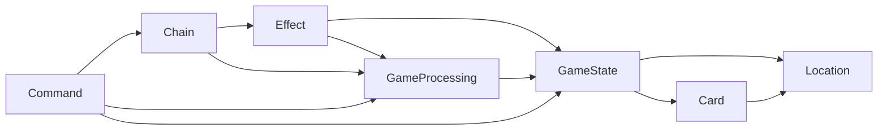

# GameState モデル設計

遊戯王の「カード」や「ルール」が静的な定義なのに対し、ゲーム中の盤面（どのカードがどこにあるか・ライフ・フェイズ）は刻一刻と変わる。  
この **動的な状態** をどう表し、どう更新するかを扱う。

> レイヤー構成は [architecture.md](./architecture.md)、静的なカード定義は [card-model.md](./card-model.md)、効果処理は [effect-model.md](./effect-model.md) を参照。

---

## ドメインモデルの全体像

ドメイン層 `models/` はルールを種類の違う 7 つのモデルに分け、依存の矢印を一方向に揃えている。  
これらのモデルは、**`GameState` を中心としたモデル群** とも言える。

- 図の右側の `Location` / `Card` は、土台として `GameState` を構成している。
- 図の左側の `Command`・`Chain`・`Effect`・`GameProcessing` は、`GameState` を参照・更新することでゲームを進行させている。



| モデル           | 役割                                            | 主な扱い                             |
| ---------------- | ----------------------------------------------- | ------------------------------------ |
| `Location`       | カードの居場所（手札・フィールド・墓地・除外…） | 本書                                 |
| `Card`           | カードの定義と 1 枚ごとの実体                   | [card-model.md](./card-model.md)     |
| `GameState`      | ゲーム状態そのもの（盤面・ライフ・フェイズ…）   | 本書                                 |
| `GameProcessing` | 状態更新の共通基盤（ステップ・イベント・検証）  | 本書                                 |
| `Effect`         | カードの効果（発動する効果・適用する効果）      | [effect-model.md](./effect-model.md) |
| `Chain`          | 効果のチェーン（チェーンブロック）              | [effect-model.md](./effect-model.md) |
| `Command`        | プレイヤー操作（召喚・発動・フェイズ移行…）     | 本書                                 |

※例外として、効果の識別子 `EffectId` だけは型参照として `GameState` / `GameProcessing` からも使われる（`activationContexts` のキー等）。値ではなく型のみの参照で、実行時の依存は上図の一方向を保つ。

---

## GameSnapshot : ゲーム全体の状態を写したイミュータブルな断面

`GameSnapshot` は「変化していくゲーム全体の断面」を表す型である。  
`GameState` は、**状態**（`GameSnapshot`）と、それを更新する **操作**（純粋関数）からなる。

**関連ファイル**: `domain/models/GameState/`（`GameSnapshot.ts` ほか）

| フィールド                 | 意味                                                           |
| -------------------------- | -------------------------------------------------------------- |
| `space`                    | カードの配置空間（`CardSpace`。後述）                          |
| `lp`                       | 両プレイヤーのライフポイント（初期 8000）                      |
| `phase`                    | 現在のフェイズ（draw → standby → main → end）                  |
| `turn`                     | ターン数                                                       |
| `result`                   | 勝敗判定                                                       |
| `normalSummonLimit / Used` | 通常召喚権の数と、このターンの使用回数                         |
| `activatedCardIds`         | 発動済みカード ID 群（「1 ターンに 1 度」制限の判定用）        |
| `activationContexts`       | 発動時に選んだ対象等を `EffectId` ごとに保持（解決後にクリア） |
| `queuedEndPhaseEffectIds`  | エンドフェイズに実行する遅延効果の ID 群                       |
| `moveCount`                | コマンド実行回数（手数の時系列）                               |

**設計意図**:

- 全フィールドが `readonly` の **イミュータブル**。状態を直接書き換えられないため、ゲーム進行は必ず「今のスナップショットを受け取り、更新した新しいスナップショットを返す」形になる。
- 振る舞いを持たないプレーンなデータなので、そのまま **JSON シリアライズ** できる。ある局面を書き出して保存し、後から読み込んで再現できる。
- この不変・直列化の要請から、`GameState` はクラス化せず、操作を純粋関数として外付けしている。

> 概念そのものは [game-rules/overview.md](../game-rules/overview.md) の「ゲーム状態」を参照。

---

## GameProcessing : 状態更新の共通基盤

すべての状態更新は、まず「今の状態に適用してよいか」を判定し、満たせば新しい状態を返し、満たさなければ状態を変えずに弾く。  
この **「判定 → 更新」の 2 段構えの共通基盤** が `GameProcessing` であり、`Command` と `Effect` で利用されている。

- `Command`: `canExecute(state)` で判定し、OK なら `execute(state)` で更新
- `Effect`（発動する効果）: `canActivate(state, source)` で判定し、OK なら発動・解決の `AtomicStep` 列で更新
- `Effect`（適用する効果）: `canApply(state)` で判定し、OK ならカテゴリに応じた介入で更新

**関連ファイル**: `domain/models/GameProcessing/`

- **`AtomicStep`**: 処理の最小単位。割り込みで差し込める、ゲーム状態更新のステップ（効果はこれを列として組み立てる → [effect-model.md](./effect-model.md)）
- **`GameEvent`**: 「何が起きたか」を表すイベント型（`EventType`、例 `spellActivated`）。ステップは反応するカードを自分で呼ばず、起きたことをこのイベントで知らせるだけに留める（純粋関数を保ち「誰が反応するか」を気にしない＝疎結合）。
  - イベント収集・差し込み処理の仲介はアプリ層の `effectQueueStore` が担う（[effect-model.md](./effect-model.md)）
- **`GameStateUpdate`（`Result`）**: 「状態がどう変わったか」を表す共通の戻り値。ステップは `Result.success(state, events)` の形で、更新後の状態と発生した `GameEvent` を一緒に返す
- **`UpdateValidation`（`Validation`）**: 「その更新を実行してよいか」の事前チェックとエラーコード（`ValidationResult`）
- **`EventTimeline`**: イベント発生の「同時／順次」を区別する時間軸（タイミング管理に使う）

---

## CardSpace / Location : カードの居場所

`GameSnapshot.space` が持つ `CardSpace` は、居場所（`LocationName`）ごとに `CardInstance` の配列を持つ盤面全体である。

**関連ファイル**: `domain/models/GameState/CardSpace.ts`、`domain/models/Location/`

- `CardSpace`: `LocationName → readonly CardInstance[]` のマップ。各ゾーンには `ZONE_CAPACITY`（モンスター/魔法罠=5、フィールド=1）がある
  - カードの移動・探索・状態更新のユーティリティ純粋関数もここに置く
- `Location`: 居場所の名前を束ねた語彙（`FIELD_LOCATIONS` / `DECK_LOCATIONS` / `OTHER_LOCATIONS` の 3 群）。手札・墓地・デッキは「ゾーン」ではないため、総称としてルールブックに無い `Location`（Zone ではなく）を充てた。

> 概念そのものは [game-rules/overview.md](../game-rules/overview.md) の「カード配置空間 / 位置」を参照。

---

## Command : プレイヤー操作の入口

「フェイズを進める」「召喚する」「魔法を発動する」といったプレイヤーの操作を、`GameCommand` という単位でカプセル化する。  
状態を書き換える唯一の入口であり、前述の「判定 → 更新」をインターフェースにそのまま写している。

**関連ファイル**: `domain/commands/`、`domain/models/Command/`

```typescript
interface GameCommand {
  readonly description: string;
  /** 状態を変更せずに、実行可能かを判定する */
  canExecute(state: GameSnapshot): ValidationResult;
  /** 実行して、更新後のゲーム状態を返す */
  execute(state: GameSnapshot): GameCommandResult;
}
```

- `execute` の戻り値 `GameCommandResult` は、更新後の状態に加えて、効果処理をアプリ層へ委譲するための `activationSteps`（発動時処理）と `chainBlock`（チェーンブロックを作る場合）を添える。以降の進行は [effect-model.md](./effect-model.md) の処理フローへ続く。
- 先攻 1 ターン目・1 人用にスコープを絞ったため、必要なコマンドは数個（フェイズ遷移・通常召喚・セット・魔法の発動・起動効果の発動・シンクロ召喚）に収まる。攻撃・反転召喚・相手の意思決定は不要。
- これらのコマンドを呼ぶ窓口はアプリ層の `GameFacade` のみ（[architecture.md](./architecture.md)）。プレゼン層はコマンドの実体を知らない。

> 概念そのものは [game-rules/command.md](../game-rules/command.md) を参照。
